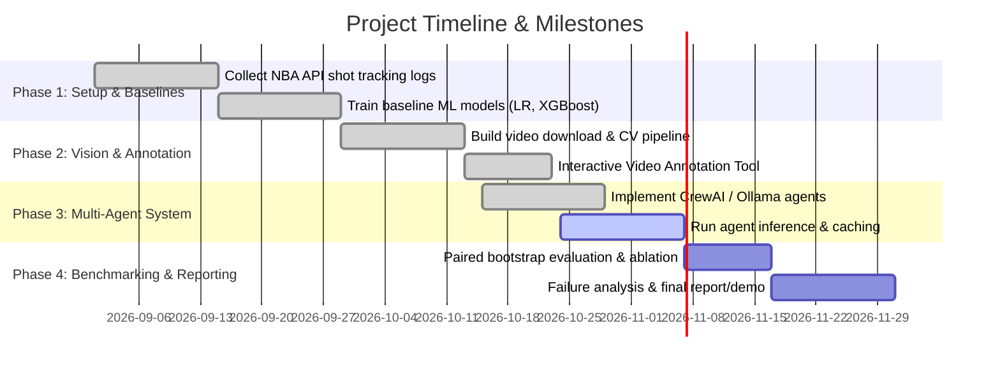

# Product Requirements Document (PRD)

## Project: Agentic NBA Shot Success Prediction
**Course**: CMSC473 – Capstone / Advanced Project  
**Team Members**: Praharsh Nanduri, Kiran Manoj, Prannav Chettipalayam, Varun Kota\
**Repository**: [agentic-NBA-prediction-CMSC473](https://github.com/Programlog/agentic-NBA-prediction-CMSC473)  
**Status**: Active Development  
**Version**: 1.0.0  

---

## 1. Executive Summary & Problem Statement

Predicting the outcome of an NBA field goal attempt is a foundational problem in modern basketball analytics. While public tabular datasets (such as the Kaggle 2014–15 shot logs containing ~128,000 attempts) provide situational context—such as shot distance, defender proximity, shot clock, and dribbles—model accuracy on pre-release positional features has historically plateaued in the mid-60% range (Meehan 2017; Grinsztajn et al. 2022). 

Proprietary optical tracking systems (such as Noah and Hawk-Eye) demonstrate that shot entry angle, ball release depth, and shooting mechanics capture substantial predictive variance beyond raw positional logs (Daly-Grafstein & Bornn 2019). However, such sensor streams are proprietary and unavailable to public research.

Simultaneously, LLM-based multi-agent workflows have become popular for predictive and forecasting tasks, yet recent literature reveals that multi-agent LLM systems are frequently overconfident, prone to hallucination, and often derive their gains from web retrieval rather than reasoning orchestration (Halawi et al. 2024).

### Core Research Objective
To build and benchmark an end-to-end, reproducible system that investigates:
1. **Computer Vision Enhancement**: Can 2D pose mechanics (release elbow angle, wrist release height, defender contest proximity/elevation) extracted from public broadcast clips improve calibrated probability estimates over tabular baselines?
2. **Agentic AI Evaluation**: Can an orchestrator of specialized LLM agents (Game Context, Player History, Shot Mechanics) rival or outperform a tuned gradient-boosted tree baseline (XGBoost), or does it introduce uncalibrated variance?

---

## 2. Target Users & Stakeholders

| Stakeholder | Use Case & Value Proposition |
|---|---|
| **Basketball Analytics Teams** | Understand shot quality independent of make/miss noise for player evaluation and tactical defense planning. |
| **Player Development Coaches** | Identify mechanical flaws at release (e.g., suboptimal elbow angle under heavy contest) that correlate with lower shot probability. |
| **Academic & ML Researchers** | Rigorous empirical benchmarks on whether multi-agent LLM reasoning adds value over tabular gradient-boosted trees on medium-scale sports data. |

---

## 3. Scope & Requirements

### 3.1 In-Scope Requirements
1. **Tabular Machine Learning Baselines**:
   - Clean and audit Kaggle 2014–15 shot logs.
   - Strict chronological splitting (whole dates together) to prevent temporal and game-level data leakage.
   - Train and evaluate Constant Base-Rate, Logistic Regression, and XGBoost baselines.
2. **Video & Computer Vision Pipeline**:
   - Retrieve official NBA broadcast video clips using `nba_api` (`VideoEventsAsset`).
   - Sample shots using hash-seeded selection without outcome bias.
   - Isolate the release frame (the exact instant the ball leaves the shooter's fingers) to eliminate trajectory and outcome leakage.
   - Run YOLO-Pose (`yolo11n-pose.pt`) to extract scale-invariant, torso-normalized geometric proxies:
     - Shooter elbow release angle (`elbow_angle_deg`)
     - Shooter wrist height relative to torso (`wrist_height_torso`)
     - Defender contest distance (`defender_distance_torso`)
     - Defender contest hand height (`defender_wrist_height_torso`)
   - Interactive annotation tool to bookmark release frames and click-assign player boxes.
3. **Agentic LLM Framework**:
   - Local, deterministic, free LLM inference via Ollama (`qwen3:4b-instruct`, temperature 0).
   - Strict budget controls to ensure fair ablations:
     - `llm_single` (1 call): Single general analyst.
     - `llm_single_budget` (4 calls): Single analyst iterated 4 times with prior rationales.
     - `llm_multi` (4 calls): CrewAI multi-agent system composed of:
       - *Game Context Analyst*
       - *Player History Analyst*
       - *Shot Mechanics & Defense Analyst*
       - *Shot Probability Aggregator*
   - Strict JSON output schema (`p_make` $\in [0, 1]$, string `rationale`).
4. **Statistical Evaluation & Calibration**:
   - Primary metric: Brier Score (mean squared error of predicted probabilities).
   - Secondary metrics: Log Loss (cross-entropy), ROC-AUC, Accuracy (threshold = 0.50).
   - Reliability diagrams (10-bin calibration curves).
   - Clustered game-level bootstrap hypothesis testing (1,000 resamples) computing 95% confidence intervals on $\Delta \text{Brier}$.
   - Validation permutation feature importance for XGBoost.

### 3.2 Out-of-Scope (Non-Goals)
- **Predicting ball trajectory after release**: Models must predict shot success *at or before* the release instant. Decoded frames after release are strictly prohibited.
- **Physical 3D court homography**: Broadcast camera angles lack calibrated intrinsic matrices; 3D coordinates are not reconstructed. Torso-normalized 2D image coordinates are used instead.
- **Commercial API dependence**: The system must run completely free of charge (no OpenAI or paid API tokens required).
- **In-game live streaming latency**: Real-time broadcast inference is not required; the pipeline operates on batch-collected clips.

---

## 4. Key Performance Indicators & Evaluation Targets

| Metric | Target / Benchmark | Rationale |
|---|---|---|
| **Brier Score** | $< 0.245$ | Baseline constant make-rate yields $\approx 0.248$. Good models lower Brier score toward 0. |
| **Probability Calibration** | Close alignment to 45° line on Reliability Diagram | Avoid overconfident predictions common in uncalibrated LLMs. |
| **Log Loss** | $< 0.670$ | Measures penalty on confident incorrect predictions. |
| **Prediction Coverage** | $100\%$ on registered cohort | Failures must be explicitly recorded and penalized rather than silently discarded. |
| **Execution Cost** | $\$0.00$ | 100% free open-source stack (local Ollama, PyTorch/YOLO, scikit-learn, XGBoost). |

---

## 5. Timeline & Milestone Deliverables

