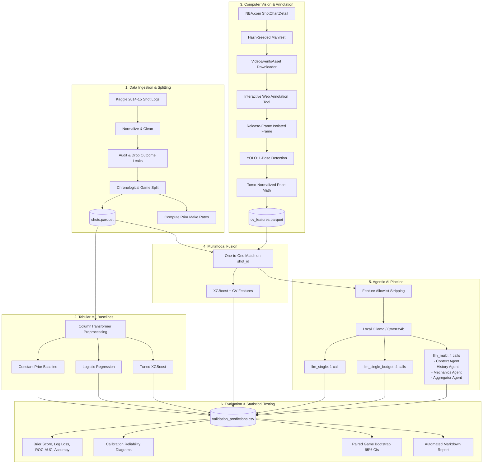

# Technical Specification (SPEC)

## Project: Agentic NBA Shot Success Prediction
**Architecture & Implementation Specification**  
**Repository**: [agentic-NBA-prediction-CMSC473](https://github.com/Programlog/agentic-NBA-prediction-CMSC473)  
**Version**: 1.0.0  

---

## 1. System Architecture

The project consists of six decoupled modules connected via strongly typed contracts, file-based checksum audits, and a unified CLI.



---

## 2. Data Schemas & Leakage Prevention Contracts

### 2.1 Tabular Shot Schema
Normalized records written to `shots.parquet` conform to the following schema:

| Column | Type | Description | Source / Mapping |
|---|---|---|---|
| `shot_id` | `string` | Unique identifier (e.g., `kaggle:0021400001:123:1`) | Composite key |
| `game_id` | `string` | 10-digit zero-padded NBA game identifier | `raw.GAME_ID` |
| `game_date` | `string` | ISO date (`YYYY-MM-DD`) | Parsed from `MATCHUP` |
| `player_id` | `string` | Official NBA player ID | `raw.player_id` |
| `cohort` | `string` | Cohort identifier (`kaggle_2014_15` or `nba_2025-26`) | Provenance tag |
| `split` | `string` | Partition tag: `train`, `validation`, or `test` | Chronological assignment |
| `y_true` | `int64` | Binary ground truth ($1 = \text{made}, 0 = \text{missed}$) | Mapped from `SHOT_RESULT` |
| `shot_distance`| `float64`| Distance from hoop in feet | `raw.SHOT_DIST` |
| `defender_distance` | `float64` | Proximity of closest defender in feet | `raw.CLOSE_DEF_DIST` |
| `shot_clock` | `float64`| Seconds remaining on shot clock ($[0, 24]$) | `raw.SHOT_CLOCK` |
| `period` | `float64`| Game quarter ($1, 2, 3, 4$) or overtime ($5+$) | `raw.PERIOD` |
| `dribbles` | `float64`| Number of dribbles prior to shot | `raw.DRIBBLES` |
| `touch_time` | `float64`| Ball possession time prior to release (seconds) | `raw.TOUCH_TIME` |
| `shot_value` | `float64`| 2-point or 3-point field goal ($2$ or $3$) | `raw.PTS_TYPE` |
| `game_clock_seconds`| `float64`| Seconds remaining in period ($\le 720$ reg, $\le 300$ OT) | Parsed `GAME_CLOCK` |
| `location` | `object` | Home (`H`) or Away (`A`) | `raw.LOCATION` |

#### Leakage Prevention Invariants:
1. **Outcome Columns Dropped**: Fields containing future knowledge (`FGM`, `PTS`, `W`, `FINAL_MARGIN`) are explicitly removed during normalization in [`normalize_kaggle`](file:///Users/prannavc/Desktop/473/agentic-NBA-prediction-CMSC473/src/nba_shots/data.py#L84).
2. **Chronological Whole-Date Splitting**: In [`assign_splits`](file:///Users/prannavc/Desktop/473/agentic-NBA-prediction-CMSC473/src/nba_shots/data.py#L182), splits partition strictly along whole dates ($70\%$ train, $15\%$ validation, $15\%$ test). Games from the same date never cross partition boundaries:
   $$\max(\text{Date}_{\text{train}}) < \min(\text{Date}_{\text{validation}}) \quad \text{and} \quad \max(\text{Date}_{\text{validation}}) < \min(\text{Date}_{\text{test}})$$
3. **Player History Anti-Leakage**: [`add_player_history`](file:///Users/prannavc/Desktop/473/agentic-NBA-prediction-CMSC473/src/nba_shots/data.py#L230) aggregates prior attempts and makes strictly from games on *strictly earlier dates*. Shots taken earlier on the *same day* are excluded to prevent intra-day leakage. Smoothed make rate uses a fixed uninformative prior:
   $$\text{prior\_make\_rate} = \frac{\text{prior\_makes} + 1}{\text{prior\_attempts} + 2} \sim \text{Beta}(1, 1)$$

---

## 3. Computer Vision & Pose Geometry Specification

### 3.1 Frame Isolation Guarantee
To avoid outcome or trajectory leakage, [`read_release_frame`](file:///Users/prannavc/Desktop/473/agentic-NBA-prediction-CMSC473/src/nba_shots/vision.py#L262) decodes strictly the single frame at `release_frame`. Follow-through frames, ball flight trajectories, and basket rim interactions are never passed to feature extractors.

### 3.2 2D Torso-Normalized Pose Math
Broadcast camera feeds lack depth sensors and court calibration matrices. To produce scale-invariant and distance-invariant features from 2D pixel coordinates, all spatial measurements are normalized by the shooter's torso length:

1. **Keypoint Extraction**: 17 COCO keypoints $(x_i, y_i, c_i)$ with confidence $c_i \ge 0.50$.
2. **Torso Reference Length ($T$)**:
   $$\text{Shoulders} = \frac{\mathbf{p}_5 + \mathbf{p}_6}{2}, \quad \text{Hips} = \frac{\mathbf{p}_{11} + \mathbf{p}_{12}}{2}$$
   $$T = \|\text{Shoulders} - \text{Hips}\|_2$$
   If $T < 10^{-6}$ or keypoint confidence $< 0.50$, features evaluate to `NaN` (handled by imputation).

3. **Feature Mathematical Definitions**:
   - **Shooter Elbow Angle (`elbow_angle_deg`)**:
     Let $\mathbf{s}, \mathbf{e}, \mathbf{w}$ be shoulder, elbow, and wrist keypoints for the shooting side (`right`: indices 6, 8, 10; `left`: 5, 7, 9):
     $$\vec{u} = \mathbf{s} - \mathbf{e}, \quad \vec{v} = \mathbf{w} - \mathbf{e}$$
     $$\theta = \arccos\left(\text{clip}\left(\frac{\vec{u} \cdot \vec{v}}{\|\vec{u}\|_2 \|\vec{v}\|_2}, -1, 1\right)\right) \times \frac{180^\circ}{\pi}$$
   - **Shooter Wrist Height (`wrist_height_torso`)**:
     Elevation of shooter's wrist relative to shoulders, normalized by torso length (positive indicates wrist above shoulders):
     $$h_{\text{wrist}} = \frac{y_{\text{shoulders}} - y_{\mathbf{w}}}{T}$$
   - **Defender Distance (`defender_distance_torso`)**:
     Distance between shooter and defender hip centers in torso units:
     $$d_{\text{defender}} = \frac{\|\text{Hips}_{\text{defender}} - \text{Hips}_{\text{shooter}}\|_2}{T}$$
   - **Defender Contest Elevation (`defender_wrist_height_torso`)**:
     Height of defender's highest contesting hand relative to shooter's shoulder line:
     $$h_{\text{contest}} = \frac{y_{\text{shoulders}} - \min(y_{\mathbf{w1}}, y_{\mathbf{w2}})}{T}$$

### 3.3 Interactive Annotation Tool Architecture
Implemented in [`src/nba_shots/annotate.py`](file:///Users/prannavc/Desktop/473/agentic-NBA-prediction-CMSC473/src/nba_shots/annotate.py):
- **Server**: Embedded `ThreadingHTTPServer` running locally on port `8765`.
- **API Surface**:
  - `GET /api/shots`: Returns manifest queue with annotation statuses.
  - `GET /api/video?shot_index=N`: Streams MP4 clip with HTTP Range request support (enabling smooth seeking).
  - `POST /api/detect-frame`: Executes YOLO detection on the specified frame and returns detected person bounding boxes.
  - `POST /api/save`: Atomically updates `release_frame`, `shooter_box`, `defender_box`, and `shooting_side` in `manifest.csv`.

---

## 4. Agentic AI Specification

### 4.1 Local Inference Engine & Budget Controls
- **Runtime**: Local Ollama server (`http://127.0.0.1:11434`), model `qwen3:4b-instruct`.
- **Zero Cost / Zero Network Leakage**: Remote API endpoints are strictly rejected before network dispatch.
- **Deterministic Hyperparameters**: `temperature = 0`, fixed seed (`42`), `num_predict = 192`.
- **Output JSON Schema**:
  ```json
  {
    "type": "object",
    "properties": {
      "p_make": { "type": "number", "minimum": 0, "maximum": 1 },
      "rationale": { "type": "string" }
    },
    "required": ["p_make", "rationale"],
    "additionalProperties": false
  }
  ```

### 4.2 Controlled Experimental Conditions
To isolate the effect of multi-agent orchestration vs. additional compute/token budgets:

| Condition | Total Calls | Architecture | Description |
|---|---|---|---|
| `llm_single` | 1 | Single Agent | Provided all allowlisted features; outputs $p_{\text{make}}$ directly. |
| `llm_single_budget` | 4 | Single Agent (Iterative) | Re-prompted 4 times with prior reasoning trace, matching multi-agent call budget. |
| `llm_multi` | 4 | CrewAI Multi-Agent System | 3 Specialist Agents + 1 Aggregator Agent. |

#### CrewAI Multi-Agent Decomposition:
1. **Game Context Analyst**: Receives period, game clock, location, and shot value.
2. **Player History Analyst**: Receives prior career attempts and prior make rate.
3. **Shot Mechanics & Defense Analyst**: Receives CV pose metrics, shot distance, defender proximity, dribbles, and touch time.
4. **Shot Probability Aggregator**: Receives all original features plus the structured outputs of the three specialists, outputting final calibrated $p_{\text{make}}$ and synthesis rationale.

---

## 5. Model Training & Evaluation Specification

### 5.1 Pipeline Preprocessing
- **Numeric Features**: Median imputation with missingness indicator (`SimpleImputer(strategy="median", add_indicator=True)`).
- **Categorical Features**: Mode imputation + one-hot encoding (`OneHotEncoder(handle_unknown="ignore")`).
- **Standardization**: Applied to Logistic Regression only (`StandardScaler`).

### 5.2 XGBoost Hyperparameters
```json
{
  "n_estimators": 300,
  "max_depth": 4,
  "learning_rate": 0.05,
  "min_child_weight": 10,
  "subsample": 0.8,
  "colsample_bytree": 0.8,
  "reg_lambda": 5,
  "objective": "binary:logistic",
  "eval_metric": "logloss"
}
```

### 5.3 Statistical Scoring & Hypothesis Testing
1. **Brier Score Loss**:
   $$\text{Brier} = \frac{1}{N} \sum_{i=1}^N (p_i - y_i)^2$$
2. **Log Loss (Cross-Entropy)**:
   $$\text{LogLoss} = -\frac{1}{N} \sum_{i=1}^N \left[ y_i \ln(p_i) + (1 - y_i) \ln(1 - p_i) \right]$$
3. **Paired Game-Clustered Bootstrap**:
   For candidate model $A$ and baseline $B$ on matching shots within game $g$:
   $$\Delta_i = (p_{i, A} - y_i)^2 - (p_{i, B} - y_i)^2$$
   Whole games are resampled $B = 1000$ times to compute the empirical $95\%$ confidence interval $[\Delta_{0.025}, \Delta_{0.975}]$. If the interval contains $0$, the candidate does not demonstrate a statistically significant improvement.
4. **Test Partition Gating**:
   Evaluating test split data (`--split test`) requires an explicit `--final` flag, guarding against snooping and p-hacking during prompt engineering and hyperparameter tuning.

---

## 6. CLI Command-Line Interface Reference

| Command | Usage | Description |
|---|---|---|
| `baseline` | `nba-shots baseline --output artifacts/run1` | Downloads, prepares, and fits baseline models on Kaggle data in one step. |
| `collect-recent` | `nba-shots collect-recent --season 2025-26 --output data/recent` | Queries `nba_api` to cache recent shot attempt logs. |
| `make-manifest` | `nba-shots make-manifest --shots data/recent/shots.parquet --output data/recent/manifest.csv` | Generates a hash-seeded, label-blind manifest for video retrieval. |
| `fetch-videos` | `nba-shots fetch-videos --manifest data/recent/manifest.csv --output data/recent/videos` | Downloads matching MP4 video clips via `VideoEventsAsset`. |
| `annotate` | `nba-shots annotate --manifest data/recent/manifest.csv --videos data/recent/videos` | Launches local web UI to bookmark release frames and click-assign player boxes. |
| `extract-cv` | `nba-shots extract-cv --manifest data/recent/manifest.csv --output data/recent/cv` | Executes YOLO-Pose and extracts torso-normalized geometric proxies. |
| `predict-llm` | `nba-shots predict-llm --shots data/recent/shots.parquet --cv data/recent/cv/cv_features.parquet --output artifacts/llm` | Runs local Ollama single/multi-agent evaluation under call budgets. |
| `compare` | `nba-shots compare --predictions p1.csv p2.csv --baseline xgboost --candidate xgboost_cv --output diff.json` | Computes paired game-clustered bootstrap intervals. |
| `report` | `nba-shots report --predictions p1.csv p2.csv --output reports/summary` | Synthesizes metrics, reliability curves, and paired comparisons into a Markdown report. |
