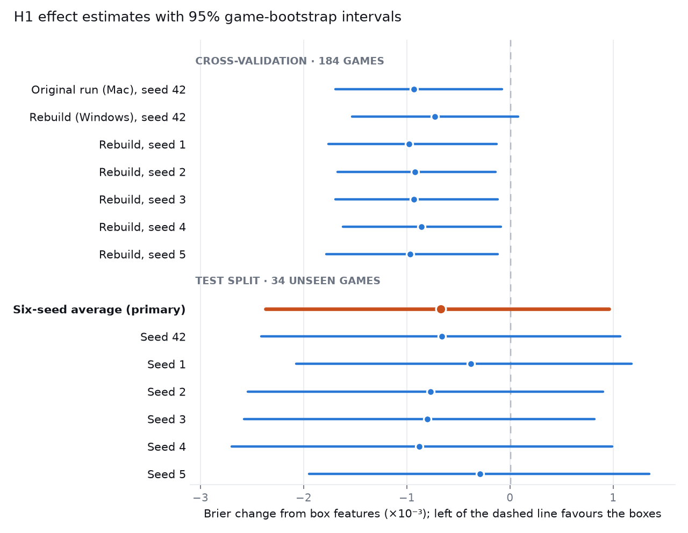

# H1 results: do release-time box measurements improve NBA shot prediction?

**Hypothesis 1:** adding computer-vision measurements of the shooter and nearest defender at
release improves shot-make prediction beyond traditional shot data.

**Answer:** yes, slightly and consistently, but the evidence is moderate. Adding nine shooter and
defender measurements from broadcast tracking boxes lowered the Brier score of a tuned XGBoost
model by about 0.0007 to 0.0009 on 2025-26 jump shots. The effect is significant across 184
development games, and the 34-game test split shows the same direction and size, but the test
split alone is too small to confirm it.

| | Brier change (box − baseline) | 95% interval | Verdict |
|---|---|---|---|
| Cross-validation, 184 games, 7,726 shots | **−0.0009** | −0.0017 to −0.0001 | significant |
| Test split, 34 unseen games, 1,546 shots (scored once) | **−0.0007** | −0.0024 to +0.0010 | not significant alone |
| Release height vs. YOLO pose, jump shots | Spearman **ρ 0.32** (all shot types 0.51) | 0.25 to 0.39 | weak agreement |

Negative Brier change means the box features helped. Intervals are paired bootstraps over whole
games (1,000 resamples).

## Data and features

- **Shots:** BasketEvent's 2025-26 clips, matched one-to-one to NBA shot records (99.99% of clip
  events matched, at the same rate for makes and misses). The cohort is unblocked jump shots with a
  detected release.
- **Box features:** BasketEvent publishes per-frame player and ball boxes from broadcast video. At
  the detected release we compute 9 features in units of the shooter's standing box height, which
  cancels camera zoom: release height, jump, ball rise speed, shooter speed; nearest defender
  distance, defenders within one body height, defender closing speed, defender on the basket
  side, defender arms up.
- **Baseline features:** shot distance, court x/y, 2 vs 3, period, game clock, home/away, shot
  type, zone, area, and the shooter's earlier-date make rate. (Defender distance, shot clock,
  dribbles and touch time have no public per-shot source for 2025-26.)
- **Model:** XGBoost, depth 2, at least 50 shots per leaf, 200 trees (design D0,
  `configs/basketevent_h1_final.json`), the same with and without the box features.

## Every estimate points the same way



| Evaluation | Run | Brier change ×10⁻³ | 95% interval | Significant |
|---|---|---|---|---|
| Cross-validation | Original run (Mac), seed 42 | −0.93 | −1.69 to −0.08 | yes |
| Cross-validation | Rebuild (Windows), seed 42 | −0.73 | −1.53 to +0.08 | no |
| Cross-validation | Rebuild, seeds 1–5 | −0.86 to −0.98 | upper ends −0.09 to −0.14 | yes, all five |
| **Test split** | **Six-seed average (primary)** | **−0.67** | **−2.37 to +0.96** | **no** |
| Test split | Seeds 42, 1–5 | −0.29 to −0.88 | all cross zero | no |

XGBoost's random row sampling makes results vary slightly by seed and machine (the cohort itself
rebuilt identically: same 7,726 shot IDs, games and labels). Because one seed could land on either
side of significance by chance, the test protocol averaged six seeds, decided before scoring.

## Test-split scores

Fit on the 152 training games (22 Oct–10 Nov 2025), scored once on the 34 test games (16–20 Nov),
XGBoost probabilities averaged over six seeds. 1,546 shots, 27% made.

| Model | Brier ↓ | Log loss ↓ | ROC-AUC ↑ |
|---|---|---|---|
| Constant (training make rate) | 0.2075 | 0.6056 | 0.500 |
| Logistic regression | 0.2009 | 0.5903 | 0.610 |
| XGBoost, tabular baseline | 0.2010 | 0.5904 | 0.605 |
| **XGBoost + 9 box features** | **0.2003** | **0.5888** | 0.609 |

The box model has the best Brier score and log loss by small margins; logistic regression edges it
on AUC. Jump shots are hard to predict: no model exceeds an AUC of 0.61.

## Do the boxes measure what we claim?

Most of the gain comes from release height: the ball's height above the shooter's feet at the
detected release. We checked it against an independent measurement, YOLO11 pose on the same
video frame, for all 1,492 cohort shots with video (pose matched the shooter on 1,196).

| Shot type | Shots | Agreement with pose (Spearman ρ) |
|---|---|---|
| Layup | 216 | 0.56 |
| Dunk | 38 | 0.53 |
| Floater | 101 | 0.44 |
| Hook | 42 | 0.33 |
| **Jump (the H1 cohort)** | **784** | **0.32** |

The threshold set before measuring was 0.5. Pooled over all shot types agreement is 0.51, mostly
because release height differs between shot types; within jump shots it is weak. In jump-shot
release frames the ball sat within a torso length of the higher wrist only 49% of the time
(threshold 70%), so the detected release frame is often slightly off. We therefore describe the
feature as a box-derived height near release, not a clean measure of shooting posture.

## How the comparison was kept fair

- **Release-time inputs only:** boxes up to release plus a few frames of ball flight; no outcome
  and nothing after the shot.
- **Missing data can leak:** clips holding several shots are mostly a miss and its putback, so
  blank box features would signal "miss". Shots without a detected release are dropped for every
  model.
- **Same shots, paired tests:** baseline and box model score identical shots; intervals resample
  whole games.
- **Chronological splits:** whole dates go to train, validation or test.
- **Written down first:** each improvement round, the measurement check and the test protocol were
  committed before being run, with their decision rules.
- **Test scored once:** after 21 logged development experiments the design was frozen and the test
  split evaluated a single time.

## What we can claim

- Box measurements near release add a small, consistent improvement to a strong tabular baseline:
  about a third of what all the tabular features add over a constant prediction, in
  cross-validation.
- The test split agrees in direction and size, with every seed negative, but 34 games cannot detect
  an effect this small (interval width 0.0033 against an effect of 0.0007).
- The main feature tracks pose only loosely within jump shots.
- Results describe BasketEvent's clips, which over-represent misses (27% of cohort jump shots made
  vs 45% of all jump shots in the same games).

## Reproduce

```bash
uv sync --frozen --all-extras
uv run --frozen --all-extras nba-shots collect-basketevent --output data/basketevent_rebuild/collection
uv run --frozen --all-extras nba-shots prepare-basketevent \
  --collection data/basketevent_rebuild/collection \
  --output data/processed/basketevent_cohort_rebuild --config configs/basketevent_h1_final.json
# Cross-validation (train + validation games only)
uv run --frozen --all-extras nba-shots cross-validate \
  --shots data/processed/basketevent_cohort_rebuild/shots.parquet \
  --cv data/processed/basketevent_cohort_rebuild/box_features.parquet \
  --config configs/basketevent_h1_final.json --output artifacts/h1_cv_d0
# Measurement check and the one-time test run
python scripts/h1_measurement_check.py measure COHORT COLLECTION OUT --stage pose
python scripts/h1_test_run.py data/processed/basketevent_cohort_rebuild artifacts/h1_test_run
```

Collection needs a Hugging Face login (`hf auth login`); downloads are rate-limited otherwise.

## Sources

- `h1_experiments.md`: the full log of all H1 experiments (sections 1–24), including ones that did
  not work.
- `h1_test_protocol.md` and `h1_measurement_check.md`: the pre-registered plans and their results.
- `reports/basketevent_h1_test/summary.json`: test-split numbers;
  `reports/basketevent_h1_cv_final/`: the original cross-validated run.
