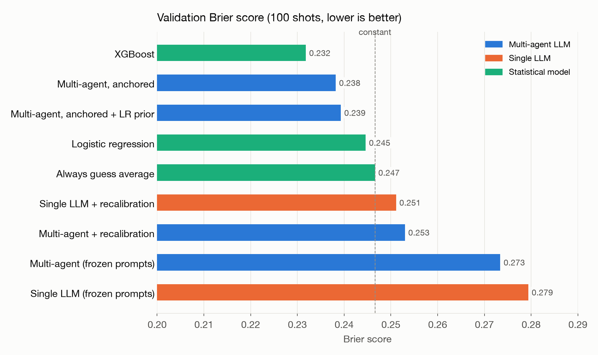
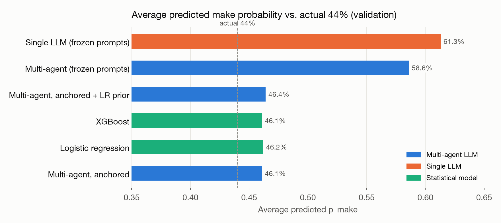
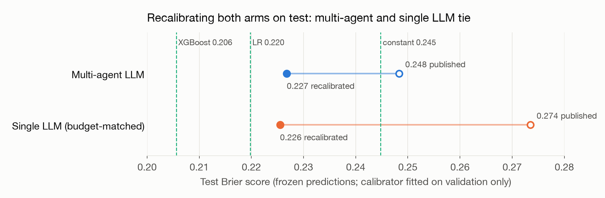

# H2 Follow-up: Fixing LLM Overconfidence (Brier Score)

**Status:** completed exploratory experiment on the **validation** split
(Nov 19, 2026). It does **not** replace the pre-registered held-out H2 result
in [the final test results](../02_final_test_100/README.md), which stands as reported.

## Motivation

In the final H2 test, every LLM condition had a worse Brier score than
logistic regression, and the multi-agent system was slightly worse than
always predicting the average make rate. The per-shot predictions show why:

| Test model (frozen run) | Mean predicted p_make | Actual make rate | Brier | ROC-AUC |
| --- | ---: | ---: | ---: | ---: |
| `llm_multi` | 0.603 | 0.42 | 0.2483 | 0.687 |
| `llm_single_budget` | 0.645 | 0.42 | 0.2735 | 0.664 |
| Logistic regression | 0.462 | 0.42 | 0.2198 | 0.681 |

The multi-agent LLM ranks shots about as well as logistic regression
(ROC-AUC 0.687 vs. 0.681), but predicts made shots about 18 percentage
points too often. The Brier problem is mainly **calibration bias**, not a lack of
signal. This follow-up tests two ways to remove that bias.

## Questions

1. Does giving each agent historical make rates from the training split
   ("anchoring") fix the overconfidence and improve Brier score?
2. Does recalibrating LLM outputs after the fact (Platt scaling fitted on
   validation) improve Brier score, and does H2's multi-agent advantage
   survive once **both** arms are recalibrated?

## Setup

- **Data:** Kaggle 2014–15 shot logs, `artifacts/day1/prepared/shots.parquet`
  (SHA-256 `4528a5be…69f1`, identical to the frozen H2 run).
- **Split:** validation only. 100 shots from 50 games (2 per game), selected
  with the project's balanced sampler and seed 42. Make rate 44%.
- **Model:** local Ollama `qwen3:4b-instruct`, digest `0edcdef3…0ba0`
  (identical to the frozen H2 run), temperature 0, seed 42.
- **Prompting:** the same `crewai_assessment` call path, instructions and
  feature definitions as the frozen run (`agents.py` prompts are unchanged
  since commit `64ee854`).
- **Execution:** 400/400 predictions succeeded, 1,000 LLM calls,
  about 4 hours on an Apple M2.

### Conditions

| Condition | Description |
| --- | --- |
| `multi` | Frozen `llm_multi`: specialist agents, then an aggregator. Reference arm. |
| `single_budget` | Frozen `llm_single_budget` control, so recalibration can be applied fairly to both arms. |
| `multi_anchored` | Same agents, but each one's role includes training-split make rates for the features it sees, and it is told to adjust from the most specific rate. |
| `multi_prior` | `multi_anchored`, plus the aggregator sees the train-fitted logistic-regression probability as a prior. |

Example anchor given to the shot-mechanics specialist for a 6–10 ft shot
with the closest defender 2–4 ft away:

> Historical reference from training shots: overall make rate 45.5%. Most
> NBA shots are missed. Shots from 6-10 ft were made 42.1% of the time
> (n=11349). Shots with the closest defender 2-4 ft away were made 47.2%
> (n=32959). With both that distance and that defender spacing: 41.9%
> (n=6204). Start from the most specific reference rate and adjust only
> modestly for the other measurements; p_make should rarely be far from it.

Rates use distance bands 0/3/6/10/16/22/24/28 ft and defender bands
0/2/4/6/10 ft, computed from the training split only. The game-context
specialist sees only the overall rate, because it has no distance features.

### Post-hoc variants (no extra LLM calls)

- **`+platt_cv`:** logistic regression on logit(p_make), fitted with
  leave-one-game-out cross-validation on validation, so no shot is
  corrected by a fit that includes its own game.
- **`+pool`:** mean of the specialists' logit probabilities instead of the
  aggregator's output.
- **Test recalibration:** a Platt map fitted on **all 100 validation
  predictions** of `multi` (or `single_budget`) is applied to the
  **already recorded** frozen test predictions of `llm_multi`
  (or `llm_single_budget`). No test labels are used for fitting and no new
  test inference is run.

Confidence intervals are 95% paired bootstrap intervals over games
(1,000 resamples, seed 42), matching the H2 protocol.

## Results

### Validation (100 shots, 44% made)

| Model | Brier ↓ | Log loss ↓ | ROC-AUC ↑ | Mean p | Δ Brier vs. `multi` [95% CI] |
| --- | ---: | ---: | ---: | ---: | --- |
| XGBoost (reference) | **0.2318** | **0.6531** | **0.590** | 0.461 | −0.042 [−0.073, −0.010] |
| **`multi_anchored`** | **0.2382** | 0.6689 | 0.555 | 0.461 | **−0.035 [−0.067, −0.004]** |
| `multi_prior` | 0.2393 | 0.6709 | 0.550 | 0.464 | −0.034 [−0.066, −0.003] |
| `multi_anchored+pool` | 0.2426 | 0.6783 | 0.527 | 0.454 | −0.031 [−0.066, +0.004] |
| Logistic regression (reference) | 0.2446 | 0.6819 | 0.546 | 0.462 | −0.029 [−0.061, +0.002] |
| Constant (reference) | 0.2466 | 0.6864 | 0.500 | 0.455 | −0.027 [−0.065, +0.009] |
| `single_budget+platt_cv` | 0.2511 | 0.6959 | 0.481 | 0.440 | −0.022 [−0.055, +0.010] |
| `multi+platt_cv` | 0.2530 | 0.6996 | 0.446 | 0.440 | −0.020 [−0.056, +0.013] |
| `multi` (frozen prompts) | 0.2734 | 0.7431 | 0.543 | 0.586 | — |
| `single_budget` (frozen prompts) | 0.2794 | 0.7634 | 0.559 | 0.613 | +0.006 [−0.008, +0.021] |
| `multi+pool` | 0.2827 | 0.7632 | 0.536 | 0.632 | +0.009 [−0.005, +0.022] |





### Test: frozen predictions recalibrated with validation-fitted maps

| Model | Brier ↓ | Log loss ↓ | ROC-AUC ↑ | Mean p |
| --- | ---: | ---: | ---: | ---: |
| XGBoost | **0.2056** | **0.5990** | **0.741** | 0.459 |
| Logistic regression | 0.2198 | 0.6299 | 0.681 | 0.462 |
| `llm_single_budget` + recalibration | 0.2255 | 0.6428 | 0.664 | 0.458 |
| `llm_multi` + recalibration | 0.2268 | 0.6461 | 0.687 | 0.449 |
| Constant | 0.2448 | 0.6827 | 0.500 | 0.455 |
| `llm_multi` (published) | 0.2483 | 0.6821 | 0.687 | 0.603 |
| `llm_single_budget` (published) | 0.2735 | 0.7451 | 0.664 | 0.645 |

| Paired test comparison | Δ Brier [95% CI] |
| --- | --- |
| `llm_multi` − `llm_single_budget` (published H2 result) | −0.025 [−0.044, −0.007] |
| `llm_multi`+recal − `llm_single_budget`+recal | **+0.001 [−0.006, +0.010]** |
| `llm_multi`+recal − `llm_multi` | −0.022 [−0.050, +0.007] |
| `llm_multi`+recal − logistic regression | +0.007 [−0.010, +0.023] |
| `llm_multi`+recal − XGBoost | +0.021 [+0.006, +0.037] |



## Findings

1. **Anchoring fixes the overconfidence.** The average prediction moves
   from 0.586 to 0.461 (actual 0.44). Brier improves by 0.035, and the
   interval excludes zero. The anchored multi-agent beats logistic regression
   and the constant baseline on validation and is within 0.006 of XGBoost.
2. **The logistic-regression prior adds nothing beyond anchoring**
   (0.2393 vs. 0.2382), so the gain does not depend on giving the LLM a
   trained model's output.
3. **Recalibration after the fact helps less than anchoring** on validation
   (−0.020, interval includes zero). Averaging specialists instead of
   using the aggregator is slightly worse than the aggregator.
4. **Important for H2:** once **both** arms are recalibrated, the
   multi-agent and budget-matched single LLM are tied on test
   (+0.001 [−0.006, +0.010]). The published H2 advantage (−0.025) appears to
   come mostly from the multi-agent being **less overconfident**, not from
   better shot discrimination. This is consistent with the limitation already
   noted in the final results ("reduced overconfidence accounts for much of
   the multi-agent improvement"), and now quantified.
5. Even recalibrated, the LLMs remain significantly worse than XGBoost on
   test (+0.021 [+0.006, +0.037]) and are statistically tied with logistic
   regression.

## Limitations

- **Exploratory and tuned on validation.** The anchoring prompt and
  conditions were chosen after seeing the frozen test results. A claim about
  anchoring on test requires a new pre-registered run.
- **No anchored single-agent arm yet.** Anchoring was applied only to the
  multi-agent system, so the anchoring gain cannot yet be credited to the
  multi-agent architecture. An anchored `single_budget` arm is the next run.
- **Small, hard validation sample.** 100 shots; even XGBoost reaches only
  0.59 ROC-AUC on these shots (0.74 on test). Intervals are wide.
- **Recalibration lowered validation ROC-AUC** in the cross-validated
  variants, because each held-out game is mapped by a slightly different
  curve. A single map (as applied on test) preserves ranking.
- **One small local model** (4B parameters, 4-bit quantized).

## Next steps

1. Run an anchored budget-matched single-agent arm on the same validation
   shots, the fair test of whether multiple agents add value once calibrated.
2. If the multi-agent still wins, pre-register a new held-out run on 100
   fresh test-split shots (different seed, no overlap with the frozen 100).
3. Repeat the anchored conditions with a stronger hosted model to test
   whether model capability, rather than architecture, drives the gains.

## Reproduce

```bash
uv sync --frozen --all-extras
# ~4 h on an M2; resumes from artifacts/h2_brier_experiments/call_cache.jsonl
uv run --frozen --all-extras python experiments/h2/04_brier_followup/run_experiments.py \
  --conditions multi multi_anchored multi_prior single_budget
uv run --frozen --all-extras python experiments/h2/04_brier_followup/analyze.py \
  --out experiments/h2/04_brier_followup/results
uv run --frozen python experiments/h2/04_brier_followup/make_figures.py
```

`run_experiments.py` expects the day-1 prepared data and models
in `artifacts/day1/` and the frozen test predictions in
`experiments/h2/02_final_test_100/report/predictions.csv`.

### Committed outputs (`results/`)

- `predictions.jsonl`: every validation prediction, including specialist opinions and rationales
- `selection.csv`: the 100 validation shots, with the logistic-regression prior
- `validation_wide.csv`: all validation models and variants, one row per shot
- `test_recalibrated.csv`: frozen test predictions plus recalibrated columns
- `summary.json`: all metrics and paired bootstrap intervals in this document
- `figures/`: the three figures above
