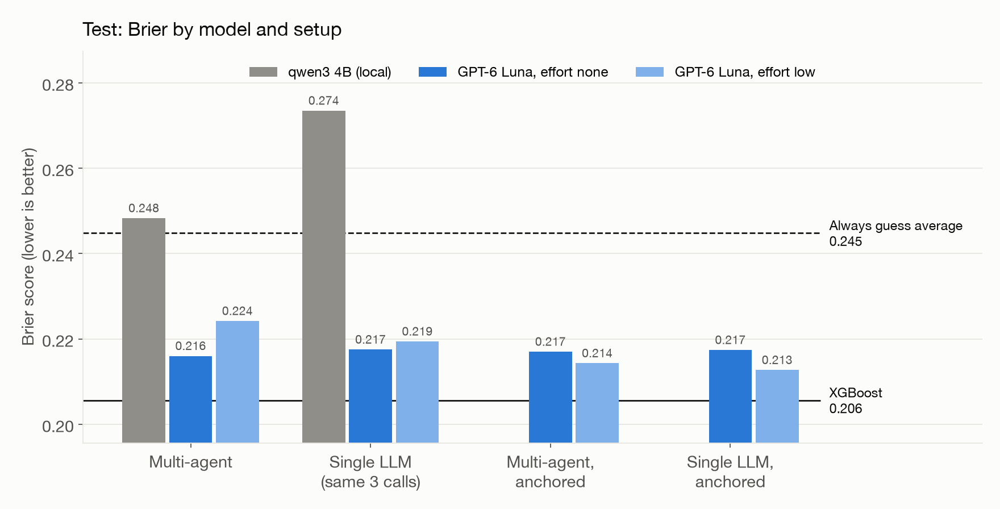
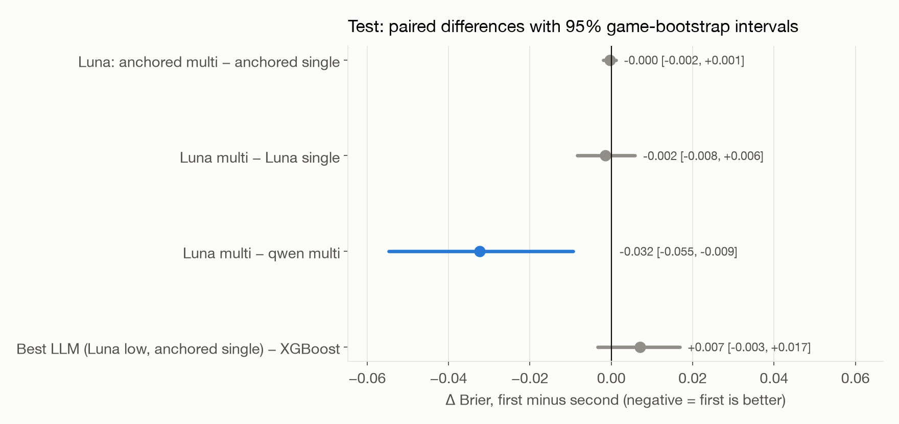
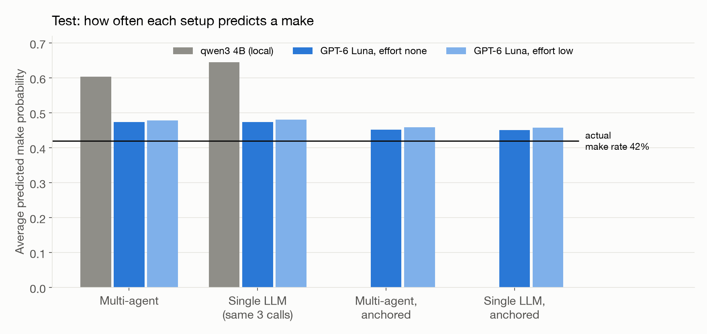
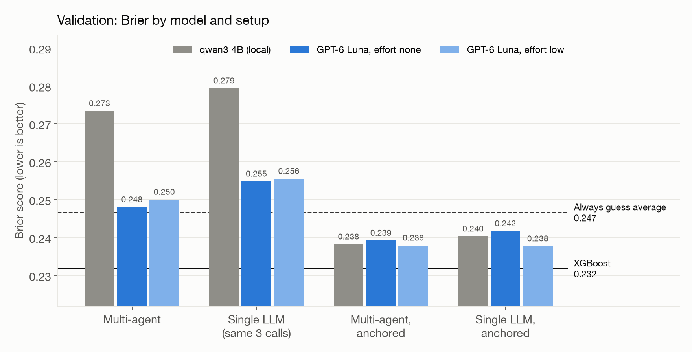

# Experiment 05: Does a Stronger Model Help? (GPT-6 Luna vs. qwen 4B)

**Status:** complete for GPT-6 Luna; the local qwen anchored conditions on test are still running (see [Pending](#pending)).
**Protocol:** [protocol.md](protocol.md), frozen and committed (`3c1f331`) after validation and **before any test call**.
**Role:** exploratory. The pre-registered H2 answer is still [02](../02_final_test_100/README.md).

## Why this experiment

Experiment 02 found that the multi-agent system beat a budget-matched single LLM on
test (Brier −0.025). However, every LLM condition was overconfident, and none beat
XGBoost. Experiment 04 showed that most of the gap was overconfidence in the small
local model (`qwen3:4b-instruct`). Anchoring agents to training make rates fixed
much of it. This experiment asks two things:

1. Does a **much stronger model** (OpenAI `gpt-6-luna`) predict better?
2. Once both systems are anchored, does **multi-agent still beat single-agent**?

## Setup

| | |
|---|---|
| Shots | the same 100 validation shots as 04, and the same 100 test shots as 02 (50 games, 2 per game, seed 42) |
| Models | `qwen3:4b-instruct` (local Ollama, temperature 0) and `gpt-6-luna` (OpenAI API, strict JSON output) |
| Luna reasoning effort | `none` (temperature 0, seed 42) and `low` |
| Conditions | multi-agent, single LLM with the same 3 calls, and both again **anchored** to training make rates |
| Analysis | Brier score; paired 95% intervals from 1,000 game-bootstrap resamples; Platt recalibration fitted on validation only |
| Cost | GPT-6 Luna: about **$0.72** for 4,800 calls (≈$0.18 per effort per split) |

The prompts, agents and anchors are the same as in 04, so the model is the only
thing that changes. `src/nba_shots/agents.py` was not modified.

## Answer

**Pre-registered comparison for this experiment.** With GPT-6 Luna (effort `none`),
the anchored multi-agent system and the anchored single LLM are **indistinguishable**:
Δ Brier = **−0.0004**, 95% CI **[−0.0020, +0.0011]**. The interval is narrow, so any
real difference is smaller than about 0.002 Brier.

1. **A stronger model helps a lot.** Unanchored, Luna beats qwen by **0.032** Brier
   for multi-agent (CI [−0.055, −0.009]) and by **0.056** for the single LLM
   (CI [−0.088, −0.022]). Luna is much less overconfident: its average prediction is
   0.47, against qwen's 0.60–0.65 and a 42% make rate.
2. **With a stronger model, the multi-agent advantage disappears.** The 02 result
   (multi − single = −0.025 with qwen) becomes **−0.002 [−0.008, +0.006]** with Luna.
   The multi-agent "win" in 02 looks like a property of a small, overconfident model:
   the aggregator mainly pulled qwen's estimates down. It is not a general benefit of
   orchestration.
3. **The best LLM gets close to XGBoost but doesn't beat it.** The anchored single
   LLM on Luna `low` was the best LLM setup on validation and again on test (0.2127).
   It beats logistic regression (0.2198) and the constant baseline (0.2448). It is
   +0.007 behind XGBoost (0.2056), with a CI of [−0.003, +0.017] that includes 0, and
   it ranks shots less well (ROC-AUC 0.704 vs. 0.741).
4. **Recalibration helps the weak model only.** Platt maps fitted on validation cut
   qwen's error a lot (0.248 → 0.227), but made Luna slightly *worse* (0.213 → 0.217).
   Luna is already reasonably calibrated, so a map fitted on 100 noisy validation
   shots mostly adds noise. After recalibration, qwen and Luna are close.
5. **Reasoning effort barely matters.** At `low`, Luna used only about 18 reasoning
   tokens per call. `low` helped the anchored conditions slightly and hurt the
   unanchored multi-agent.

## Results

### Test (100 shots, 42% made)

| Setup | qwen 4B | Luna `none` | Luna `low` |
|---|---:|---:|---:|
| Multi-agent | 0.2483 | 0.2160 | 0.2242 |
| Single LLM (3 calls) | 0.2735 | 0.2175 | 0.2194 |
| Multi-agent, anchored | *pending* | 0.2170 | 0.2143 |
| Single LLM, anchored | *pending* | 0.2174 | **0.2127** |

References: XGBoost **0.2056**, logistic regression 0.2198, constant 0.2448.
The qwen multi-agent and single LLM numbers are the frozen 02 predictions.



### Paired comparisons on test (Δ Brier, first minus second; negative favors the first)

| Comparison | Δ | 95% CI | Verdict |
|---|---:|---|---|
| **Luna `none`: anchored multi − anchored single** (primary) | **−0.0004** | **[−0.0020, +0.0011]** | **no difference** |
| Luna `none`: multi − single | −0.0015 | [−0.0084, +0.0058] | no difference |
| Luna `low`: anchored multi − anchored single | +0.0016 | [−0.0002, +0.0039] | no difference |
| Luna `low`: multi − single | +0.0048 | [−0.0046, +0.0153] | no difference |
| qwen: multi − single (02, for reference) | −0.0252 | [−0.0441, −0.0073] | multi better |
| Luna `none` multi − qwen multi | −0.0323 | [−0.0547, −0.0094] | Luna better |
| Luna `none` single − qwen single | −0.0561 | [−0.0881, −0.0219] | Luna better |
| Luna `low` multi − qwen multi | −0.0241 | [−0.0454, −0.0020] | Luna better |
| Best LLM (Luna `low`, anchored single) − XGBoost | +0.0071 | [−0.0033, +0.0168] | no difference (XGBoost ahead) |





### Test after validation-fitted recalibration (descriptive)

| Setup | qwen 4B | Luna `none` | Luna `low` |
|---|---:|---:|---:|
| Multi-agent | 0.2268 | 0.2275 | 0.2324 |
| Single LLM (3 calls) | 0.2255 | 0.2324 | 0.2332 |
| Multi-agent, anchored | *pending* | 0.2225 | 0.2182 |
| Single LLM, anchored | *pending* | 0.2249 | 0.2172 |

After recalibration, the best LLM is +0.012 behind XGBoost, CI [+0.001, +0.021].

### Validation (100 shots, 44% made)

| Setup | qwen 4B | Luna `none` | Luna `low` |
|---|---:|---:|---:|
| Multi-agent | 0.2734 | 0.2480 | 0.2500 |
| Single LLM (3 calls) | 0.2794 | 0.2548 | 0.2555 |
| Multi-agent, anchored | 0.2382 | 0.2392 | 0.2379 |
| Single LLM, anchored | 0.2403 | 0.2417 | **0.2377** |

References: XGBoost 0.2318, logistic regression 0.2446, constant 0.2466.
On validation, every multi − single difference had an interval that included 0. With
anchoring, Luna and qwen were tied.



## Interpretation for H2

The 02 result holds for its frozen setup: with qwen 4B, multi-agent orchestration
improved Brier. This experiment shows the effect **does not carry over to a
stronger model**, and it vanishes once the calibration problem is handled directly
with anchoring. A fair summary for the report:

> Multi-agent orchestration helped a small, overconfident model mainly by moderating
> its probabilities. With a stronger model, or with calibration anchors, a single LLM
> given the same calls performs the same. Better models matter far more than
> orchestration: GPT-6 Luna cut Brier by 0.03–0.06 and came within 0.007 of XGBoost.

## Limitations

- 100 test shots in 50 games, one season of tabular data, and no computer-vision features.
- Effort `low` doesn't fix temperature or seed, so those runs are not exactly reproducible.
  At `none`, the API takes temperature 0 and a seed, but hosted models can still drift.
- `gpt-6-luna` is a moving alias with no dated snapshot. Re-runs may hit a newer model.
- Many comparisons with no multiplicity correction. Only the primary one is confirmatory
  within this experiment.
- Choosing "best LLM" uses validation, which picked the same condition that was best on test.
- **Deviation:** in the validation runs, the per-call cost and token fields were mislogged
  under parallel workers. Predictions were not affected, and this was fixed before the
  test run (see protocol). Validation costs come from the runner's live totals.

## Pending

The local qwen **anchored** conditions on the test split are still running (about 3 h on
an M2). When they finish, re-run the analysis and figures. The qwen "pending" cells and
the Luna-vs-qwen anchored comparisons will fill in automatically.

## Files

| File | What it is |
|---|---|
| [protocol.md](protocol.md) | test protocol, frozen before test calls |
| [openai_client.py](openai_client.py) | OpenAI client with the same interface as `OllamaClient`, a USD cost cap and a request throttle |
| [run_experiments.py](run_experiments.py) | runner (cached, resumable, parallel); reuses 04's anchors and conditions |
| [analyze.py](analyze.py) | metrics, recalibration and paired game bootstrap; writes `results/summary.json` |
| [make_figures.py](make_figures.py) | figures in `results/figures/` |
| `results/runs/*/` | predictions, shot selections and run metadata for each model, effort and split |

## Reproduce

Put `OPENAI_API_KEY=...` in `.env` (gitignored). Then, from the repository root:

```bash
R="uv run --frozen --all-extras python experiments/h2/05_stronger_model/run_experiments.py"
for split in validation test; do
  for e in none low; do $R --backend openai --reasoning-effort $e --split $split --rpm 40; done
done
$R --backend ollama --split validation   # reuses 04's cache for 3 of 4 conditions if copied in
$R --backend ollama --split test --conditions multi_anchored single_budget_anchored
uv run --frozen --all-extras python experiments/h2/05_stronger_model/analyze.py
uv run --frozen python experiments/h2/05_stronger_model/make_figures.py
```
