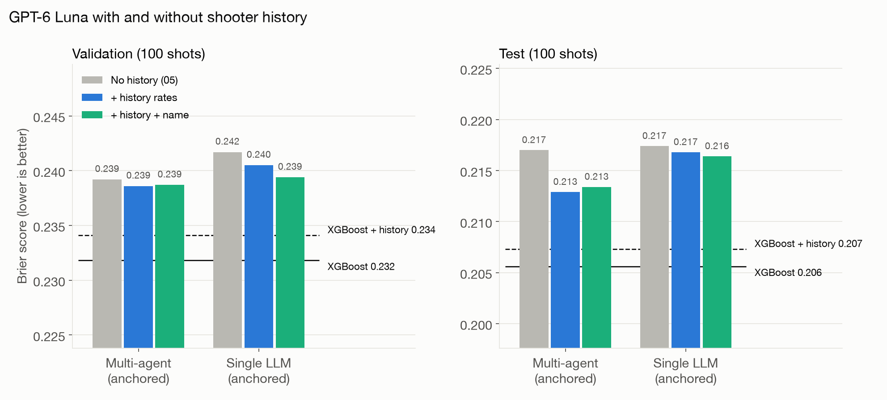
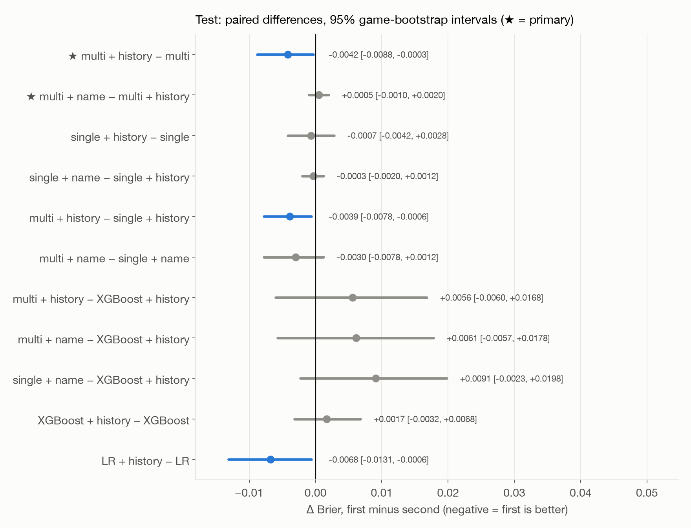
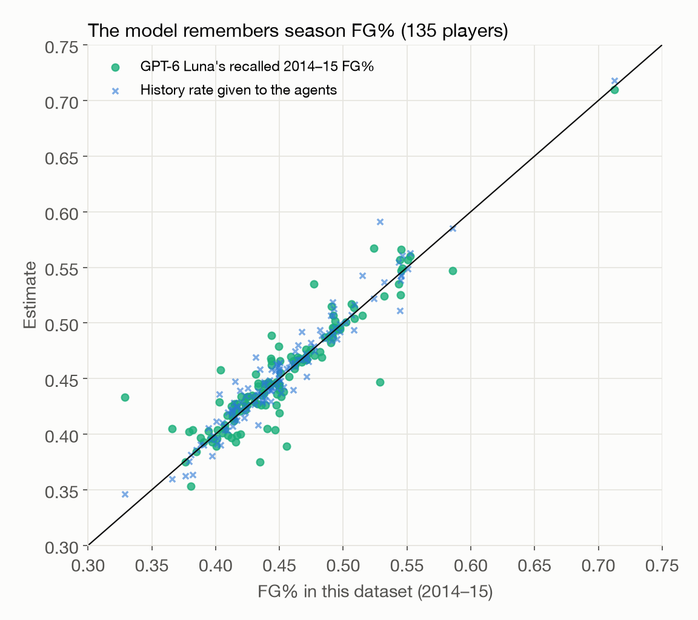

# Experiment 06: Shooter History — Does Knowing the Player Help the Agents?

**Status:** complete.
**Protocol:** [protocol.md](protocol.md), frozen and committed (`fd8f4c8`) after validation and **before any test call**.
**Role:** exploratory. The pre-registered H2 answer is still [02](../02_final_test_100/README.md).

## Why this experiment

In [experiment 05](../05_stronger_model/README.md), GPT-6 Luna fixed the calibration
problem but still trailed XGBoost (0.213 vs. 0.206). Its predictions tracked
XGBoost's closely (r = 0.89), so the agents were not adding information beyond the 9
tabular features they share with XGBoost. This experiment gives them something new:
the **shooter's history**.

- **Arm A, history rates:** the player's make rate in earlier games, overall and from
  the shot's distance band.
- **Arm B, history + name:** the same rates plus the player's **name**, so the model
  can use its own knowledge of the player.

For a fair H2 comparison, XGBoost and logistic regression were retrained with the
**same history features**.

## Setup

| | |
|---|---|
| Model | GPT-6 Luna (`gpt-6-luna`), reasoning effort `none`, temperature 0, seed 42 |
| Shots | the same 100 validation and 100 test shots as 02, 04 and 05 |
| History features | overall prior attempts and make rate (existing `add_player_history`), plus the prior make rate in the shot's distance band, shrunk toward the league rate (k = 20). **Earlier dates only** |
| Conditions | anchored multi-agent (the existing *Player history analyst* is now on: 3 specialists + aggregator) and an anchored single LLM with the same 4 calls, each in arm A and arm B |
| Comparison without history | 05's Luna `none` anchored predictions on the same shots |
| Analysis | Brier; paired 95% intervals from 1,000 game-bootstrap resamples (seed 42) |
| Cost | $0.47 (2,800 new calls) + $0.002 for the contamination probe |

Leakage checks:
- The history for 20 random selected shots was recomputed from earlier-date shots,
  with 0 mismatches.
- No player name appears in arm A prompts.
- The local baseline pipeline without history reproduces day-1 XGBoost (difference 1e-16).

## Answer

1. **History helps the multi-agent system a little (primary 1).** Multi + history −
   multi = **−0.0042**, 95% CI **[−0.0088, −0.0003]**. The interval sits just below 0.
   On validation the same difference was −0.0006 [−0.003, +0.002], so treat this as
   a small, borderline effect.
2. **Adding the name does not help (primary 2).** Multi + name − multi + history =
   **+0.0005 [−0.0010, +0.0020]**. The model clearly knows these players (see below),
   but that knowledge repeats what the history rate already says.
3. **Only the multi-agent design uses the history.** For the single LLM, history
   changed Brier by −0.0007 [−0.004, +0.003]. With history, multi beat single:
   **−0.0039 [−0.0078, −0.0006]**. That makes sense: a dedicated *Player history analyst*
   gives the multi-agent system a real division of information, which it lacked before.
   This is the most favourable multi-agent result since 02, but it is small and
   borderline, and not confirmed on validation (−0.0018 [−0.006, +0.002]).
4. **XGBoost still wins.** The best LLM (multi + history, 0.2129) is +0.0056
   [−0.006, +0.017] behind XGBoost with history (0.2073), and further behind XGBoost
   without history (0.2056). History did not help XGBoost (+0.0017 [−0.003, +0.007]).
   It did help logistic regression (−0.0068 [−0.013, −0.001]), which then ties the
   best LLM (0.2131 vs. 0.2129).

## Results

### Test (100 shots, 42% made)

| | No history (05) | + history rates | + history + name |
|---|---:|---:|---:|
| Multi-agent, anchored | 0.2170 | **0.2129** | 0.2134 |
| Single LLM, anchored | 0.2174 | 0.2168 | 0.2164 |
| XGBoost | **0.2056** | 0.2073 | — |
| Logistic regression | 0.2198 | 0.2131 | — |
| Constant | 0.2448 | 0.2448 | — |





### Validation (100 shots, 44% made)

| | No history (05) | + history rates | + history + name |
|---|---:|---:|---:|
| Multi-agent, anchored | 0.2392 | 0.2386 | 0.2387 |
| Single LLM, anchored | 0.2417 | 0.2405 | 0.2394 |
| XGBoost | **0.2318** | 0.2341 | — |
| Logistic regression | 0.2446 | 0.2428 | — |

Every validation difference had an interval that included 0.

### Contamination probe: the model remembers season stats

We asked Luna for each of the 135 players' 2014–15 field-goal percentage, with no
shot context, and compared its answers with the FG% in this dataset.

| | Correlation with dataset FG% | Mean absolute error |
|---|---:|---:|
| GPT-6 Luna's recalled FG% | 0.917 | 1.2 points (65% within 1 point; always "high" confidence) |
| History rate given to the agents | 0.973 | 0.9 points |

The model has memorized season-level shooting stats, so arm B's "knowledge" partly
includes the test season's outcomes. This has to be stated whenever named-player
prompts are used. Here it did not matter: the earlier-games history rate already
carries the same information more precisely, and arm B did not beat arm A.



## Interpretation for H2

- Giving the agents **new information** produced the first measurable gain for the
  multi-agent design over its single-LLM control with a strong model. The gain is
  small: about 0.004 Brier, with an interval just below 0 on test and not seen on
  validation. It appears only when a specialist owns that information, which is the
  case where orchestration should help.
- It did not close the gap to XGBoost. Shooter make rates carry little signal beyond
  shot distance and defender distance, both on these 100 shots and on the full splits
  (adding them changed full-split XGBoost Brier by less than 0.0004).
- Player-name knowledge in the LLM is real but redundant with the history rates, and
  it is contaminated with season outcomes, so it should not be relied on.

## Limitations

- 100 test shots in 50 games. Two primary comparisons, plus many secondary ones, with no
  multiplicity correction. The positive results have upper bounds close to 0.
- Only GPT-6 Luna at effort `none`. `gpt-6-luna` is an alias with no dated snapshot.
- The history rates use earlier validation and test games for later shots in the same
  split. This is "online" history, which is realistic for live prediction, and both the
  LLMs and the baselines get the same features.
- The dataset FG% used in the contamination probe includes every shot in the season,
  including the selected ones. It is a season-level check, not a per-shot one.

## Files

| File | What it is |
|---|---|
| [protocol.md](protocol.md) | test protocol, frozen before test calls |
| [prepare.py](prepare.py) | builds the history features and player names; retrains the baselines with history and checks day-1 reproduction |
| [run_experiments.py](run_experiments.py) | the 4 conditions on Luna; reuses 05's client and cache and 04's anchors |
| [contamination.py](contamination.py) | season FG% recall probe |
| [analyze.py](analyze.py), [make_figures.py](make_figures.py) | comparisons and figures |
| `results/` | summary.json, wide CSVs, per-run predictions, history-baseline predictions for the selected shots, contamination results, figures |

## Reproduce

Put `OPENAI_API_KEY` in `.env`. Then, from the repository root:

```bash
P="uv run --frozen --all-extras python experiments/h2/06_shooter_history"
$P/prepare.py
$P/run_experiments.py --split validation
$P/contamination.py
$P/run_experiments.py --split test
$P/analyze.py
uv run --frozen python experiments/h2/06_shooter_history/make_figures.py
```

`analyze.py` reads 05's `results/*_wide.csv` for the comparison without history, and
`artifacts/h2_history/` for the run outputs.
