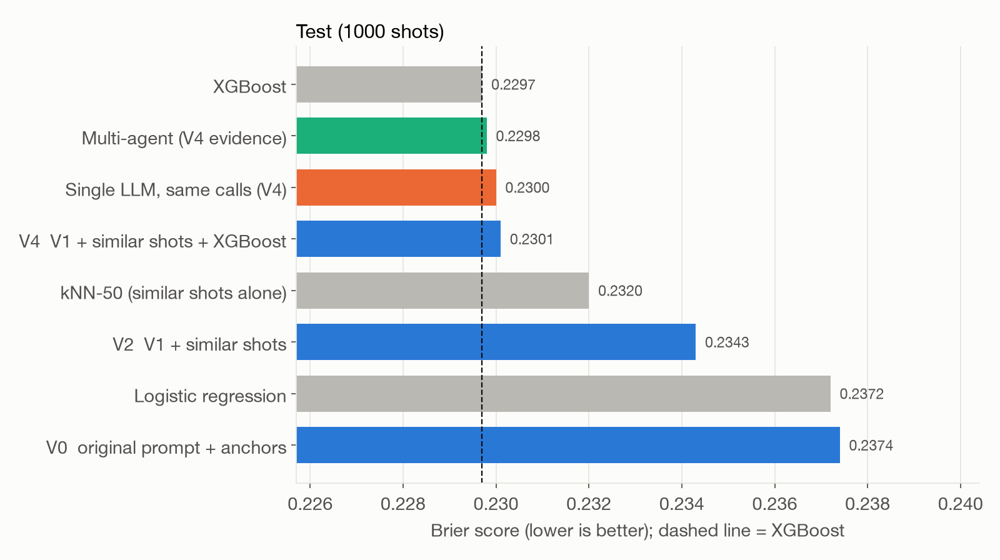
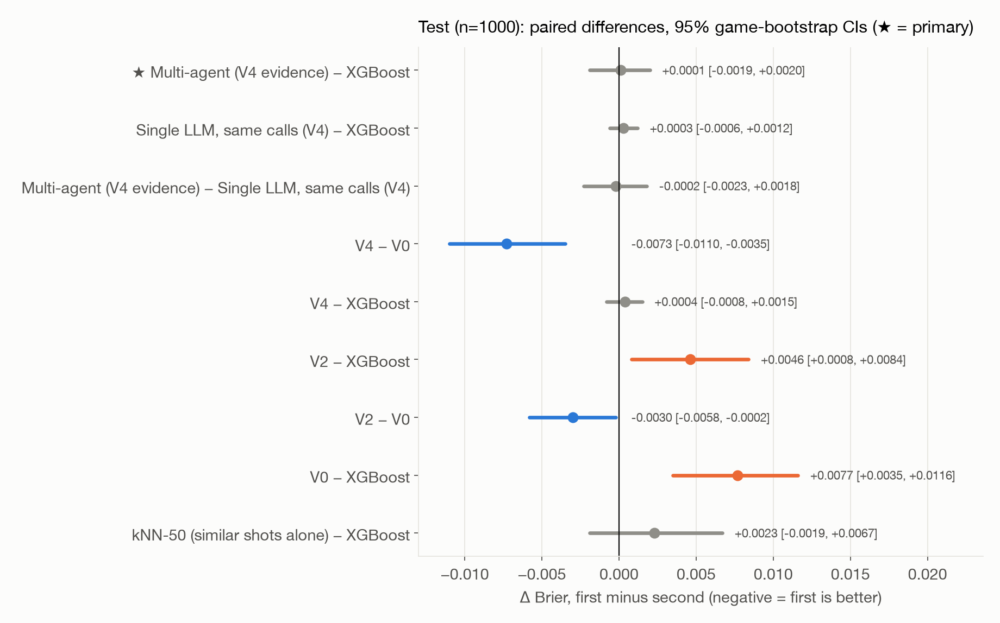
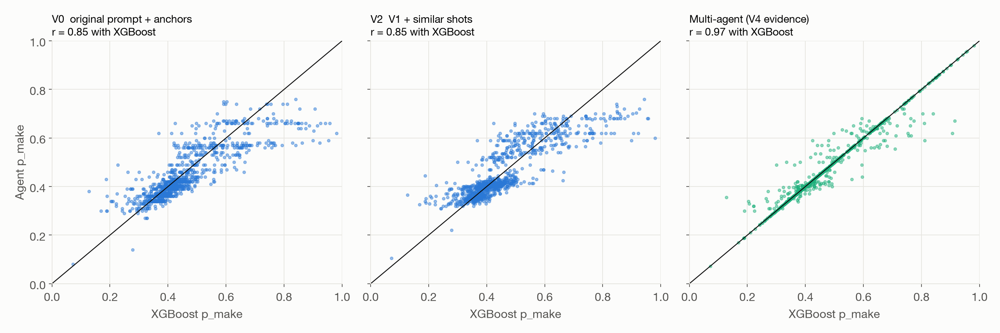
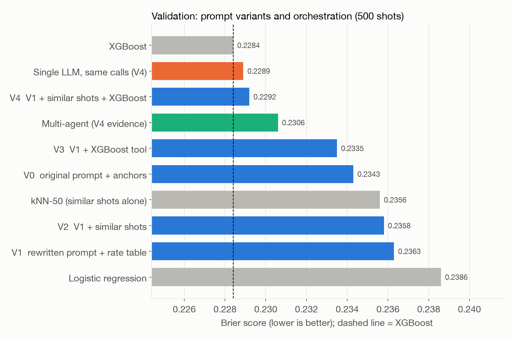

# Experiment 07: Better Prompts, Similar Shots, and XGBoost as a Tool

**Status:** complete.
**Protocol:** [protocol.md](protocol.md). Validation rules were committed before any validation call (`6a2e203`). The test protocol was committed after validation and **before any test call** (`26e4297`).
**Role:** exploratory. The pre-registered H2 answer is still [02](../02_final_test_100/README.md).

## Why this experiment

In 05 and 06, the best LLM setup (GPT-6 Luna) came within about 0.007 Brier of XGBoost
but never beat it. The agent prompts (`release-v4-feature-semantics`) were frozen for
pre-registration and never tuned for accuracy. This experiment asks:

1. Do **better prompts** help? These are rewritten instructions, a training make-rate
   table, and reasoning before the number.
2. Does giving the agents **new evidence** help? Two kinds are tested: the 50 most
   similar training shots with their outcomes, and the XGBoost estimate as a
   "statistical model tool".
3. With that evidence, can the agents — and the multi-agent system in particular —
   **beat XGBoost**?

Every choice was made on 500 validation shots. The test used **1,000 shots**, 10× the
size of 02's sample, so differences of about 0.002 Brier can be detected.

## Setup

| | |
|---|---|
| Model | `gpt-6-luna`, effort `none` (temperature 0, seed 42), strict JSON output |
| Validation | 500 shots, 125 games × 4. It contains the 100 validation shots from 04–06 |
| Test | 1,000 shots, 125 games × 8. 900 of them are **fresh** (never used before), and results are also reported on those alone |
| Features | the 9 day-1 tabular features (06 showed shooter history adds nothing) |
| Evidence | computed in [prepare.py](prepare.py) from the training split only (91k shots) |
| Analysis | Brier score; paired 95% intervals from 1,000 game-bootstrap resamples (seed 42) |
| Cost | $1.36 validation + $2.33 test = **$3.69** for about 18,000 calls |

### Prompt variants (one CrewAI agent call per shot)

| ID | Instructions | Evidence in the agent's role |
|---|---|---|
| V0 | original `INSTRUCTIONS` (as in 05) | 04's make-rate anchors |
| V1 | **rewritten**: start from the distance base rate, adjust part of the way for each factor, reason before giving `p_make`, 3 decimals | make-rate table: the distance-band rate, then rates within that band by defender distance, shot clock, dribbles and touch time |
| V2 | V1 | rate table + **similar shots** (made count among the 50 nearest training shots, plus the 5 nearest listed) |
| V3 | V1 | rate table + **XGBoost estimate** |
| V4 | V1 | rate table + similar shots + XGBoost estimate |

The full rendered prompts for the first shot of every condition are in
`results/runs/*/prompts/`. With the winning evidence set, V4:

- **`multi:V4`** uses one specialist per evidence type: a shot difficulty analyst,
  a similar-shots analyst and a statistical model analyst. An aggregator then sees
  all the evidence and opinions. That is 4 calls per shot.
- **`single_budget:V4`** is one analyst with all the evidence, making 4 sequential
  calls.

## Answer

**Pre-registered comparison for this experiment.** The multi-agent system scored
**0.2298**, against XGBoost's **0.2297**: Δ = **+0.0001**, 95% CI
**[−0.0019, +0.0020]**. This is a **tie**. The agents now match the baseline, but they
don't beat it, and any real difference is smaller than about 0.002 Brier.

1. **Prompt rewriting alone didn't close the gap.** On validation, the rewritten
   instructions (V1, 0.2363) scored about the same as the original (V0, 0.2343). On
   test, the rewritten prompt with similar shots (V2) did beat V0 (−0.003
   [−0.006, −0.0002]), but it is still clearly behind XGBoost (+0.0046
   [+0.0008, +0.0084]). The prompts were not the main bottleneck.
2. **Similar shots add little.** kNN-50 on its own (0.2320) is worse than XGBoost.
   Adding it to the rate table gives V2, which still loses to XGBoost.
3. **The XGBoost tool is what makes the agents competitive.** V4 improves on the
   original prompt by **−0.007** Brier (CI [−0.011, −0.004]) and ties XGBoost. But the
   agents mostly copy the tool: the single analyst is within 0.005 of XGBoost on 92–96%
   of shots. The multi-agent aggregator deviates more often, on 21% of shots, and those
   deviations average out to nothing (0.2358 vs. 0.2353 on those shots).
4. **Multi-agent vs. single-agent: still no difference.** With the same calls and the
   same evidence, `multi:V4` − `single_budget:V4` = −0.0002 [−0.0023, +0.0018]. This
   matches 05.
5. **The same holds on the 900 fresh test shots.** Multi-agent − XGBoost is +0.0002
   [−0.0018, +0.0022], and V4 − V0 is −0.007 [−0.011, −0.003].

## Results

### Test (1,000 shots, 46% made)

| Setup | Brier | ROC-AUC | Within 0.005 of XGBoost |
|---|---:|---:|---:|
| XGBoost | **0.2297** | 0.637 | — |
| Multi-agent (V4 evidence) | 0.2298 | 0.635 | 79% |
| Single LLM, same 4 calls (V4) | 0.2300 | 0.636 | 96% |
| V4, one call | 0.2301 | 0.635 | 92% |
| kNN-50 (similar shots alone) | 0.2320 | 0.627 | 5% |
| V2: rewritten prompt + rate table + similar shots | 0.2343 | 0.624 | 8% |
| Logistic regression | 0.2372 | 0.618 | 5% |
| V0: original prompt + anchors | 0.2374 | 0.615 | 10% |
| Constant | 0.2484 | 0.500 | — |



### Paired comparisons on test (Δ Brier, first minus second; negative favors the first)

| Comparison | All 1,000 | 900 fresh shots |
|---|---|---|
| **Multi-agent − XGBoost** (primary) | **+0.0001 [−0.0019, +0.0020]** | +0.0002 [−0.0018, +0.0022] |
| Single LLM (same calls) − XGBoost | +0.0003 [−0.0006, +0.0012] | +0.0001 [−0.0008, +0.0011] |
| Multi-agent − single LLM | −0.0002 [−0.0023, +0.0018] | +0.0001 [−0.0019, +0.0021] |
| V4 − V0 (does the new prompt + evidence help?) | **−0.0073 [−0.0110, −0.0035]** | −0.0071 [−0.0109, −0.0033] |
| V4 − XGBoost | +0.0004 [−0.0008, +0.0015] | +0.0002 [−0.0011, +0.0014] |
| V2 − XGBoost (best agent without the tool) | +0.0046 [+0.0008, +0.0084] | +0.0046 [+0.0006, +0.0086] |
| V2 − V0 | −0.0030 [−0.0058, −0.0002] | −0.0027 [−0.0054, +0.0004] |
| V0 − XGBoost | +0.0077 [+0.0035, +0.0116] | +0.0073 [+0.0032, +0.0116] |
| kNN-50 − XGBoost | +0.0023 [−0.0019, +0.0067] | +0.0013 [−0.0029, +0.0060] |





### Validation (500 shots, 45% made)

| Setup | Brier | ROC-AUC |
|---|---:|---:|
| XGBoost | 0.2284 | 0.633 |
| Single LLM, same 4 calls (V4) | 0.2289 | 0.629 |
| V4 | **0.2292** (chosen as W) | 0.629 |
| Multi-agent (V4 evidence) | 0.2306 | 0.626 |
| V3 | 0.2335 | 0.625 |
| V0 | 0.2343 | 0.604 |
| kNN-50 | 0.2356 | 0.610 |
| V2 | 0.2358 (best without the tool) | 0.605 |
| V1 | 0.2363 | 0.598 |
| Logistic regression | 0.2386 | 0.602 |



## Interpretation for H2

Across 05–07, the pattern is consistent:

> With the nine tabular features, an LLM agent cannot extract more signal than XGBoost.
> Better prompts and similar-shot retrieval narrow the gap. Giving the agents the
> XGBoost estimate as a tool closes it: on 1,000 test shots, the multi-agent system
> ties XGBoost to within ±0.002 Brier. The agents don't beat it, because they have no
> information XGBoost lacks, and when they deviate from the tool the deviations are
> noise. Multi-agent orchestration again performs the same as a single LLM given the
> same calls.

The ceiling is in the data, not the agents. On the full test split, XGBoost reaches
only ROC-AUC 0.65, and adding shooter history, defender identity or in-game form
doesn't improve it (06 and the pre-checks). Beating the baseline would need
information the tabular model doesn't have: shot video (the H1 computer-vision
features), shot type, or play context.

## Limitations

- One model (`gpt-6-luna`, a moving alias) at a single effort level. Results may drift
  if the alias is updated.
- V1–V4 share one rewritten instruction text. Other wordings might do better, but the
  ceiling argument above limits how much any prompt can gain.
- The XGBoost "tool" is precomputed and placed in the prompt. The agent doesn't call it
  through function calling.
- The test sample includes the 100 test shots used in 02–06. Every result is also
  reported on the 900 fresh shots and holds there.
- No multiplicity correction. Only the primary comparison is confirmatory within this
  experiment.
- **Deviation:** the first stage-2 validation pass lost 280 shots to connection errors.
  They were retried on resume with identical prompts (the cache is keyed by messages),
  and all conditions finished at 100% `ok`.

## Files

| File | What it is |
|---|---|
| [protocol.md](protocol.md) | validation rules, and the test protocol frozen before test calls |
| [prepare.py](prepare.py) | selections (an uncapped copy of the frozen sampler, checked for equality), baseline and kNN predictions, rate tables |
| [prompts.py](prompts.py) | prompt variants V0–V4 and the specialist roles |
| [run_experiments.py](run_experiments.py) | cached, resumable, parallel runner; reuses 05's client and cache |
| [analyze.py](analyze.py) | metrics, copy rate, paired game bootstrap; writes `results/summary.json` |
| [make_figures.py](make_figures.py) | figures in `results/figures/` |
| `results/prepare.json` | data hashes and reference metrics on the selections and full splits |
| `results/runs/*/` | predictions (with every agent's rationale), selections, rendered prompts and run metadata |

## Reproduce

Put `OPENAI_API_KEY=...` in `.env` (gitignored). Then, from the repository root:

```bash
P="uv run --frozen --all-extras python experiments/h2/07_prompt_tuning"
$P/prepare.py
$P/run_experiments.py --split validation --conditions V0 V1 V2 V3 V4 multi:V4 single_budget:V4 --rpm 600 --workers 16
$P/run_experiments.py --split test --conditions V0 V2 V4 multi:V4 single_budget:V4 --rpm 600 --workers 16
$P/analyze.py --winner V4 --nomodel V2
uv run --frozen python experiments/h2/07_prompt_tuning/make_figures.py
```
