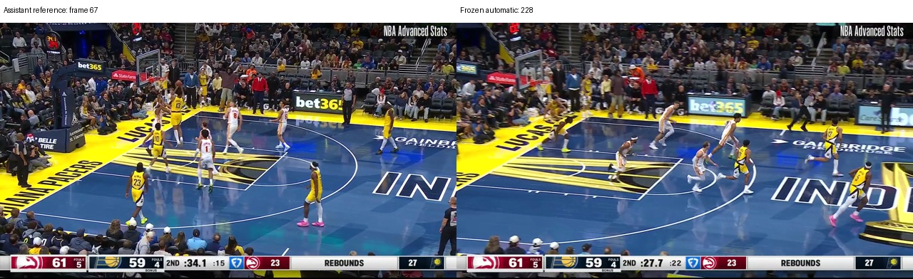
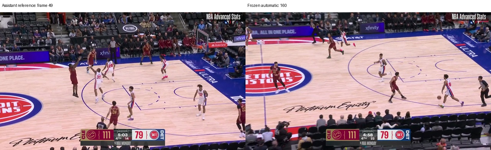
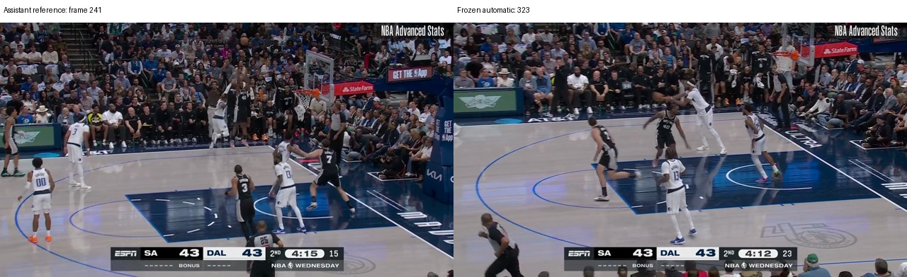
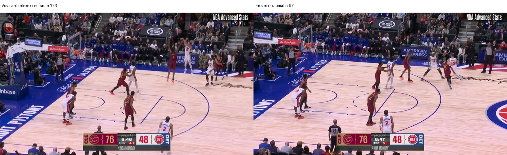
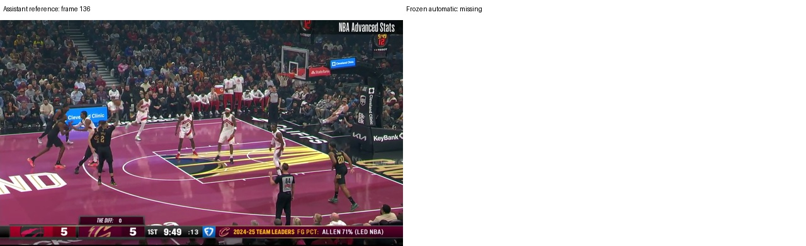

# Blind release detection audit

Automatic release detection agreed within ±3 frames with assistant-reviewed references on **27/43 shots (62.8%; 95% Wilson CI 47.9–75.6%)**.
43/50 sampled clips were scorable. Confirmed timing matches across all sampled clips: 27/50.

References are assistant visual annotations, not independent human ground truth. Conclusions apply only to the frozen video-available subset. Missing automatic detections count as failures when a clear aligned reference exists. Unscorable references are retained, not replaced.

Timing categories: {"within_3": 27, "early": 8, "late": 5, "missing": 3, "unscorable": 7}.
Median absolute error among detected, scorable shots: 1.5 frames.

- Shooter identity agreement: 43/49.
- Defender identity agreement: 30/46.

## Method and scope

The pool contained **851 unique video-associated shot events** across 11 games.
Exactly 50 unique IDs were sampled without replacement after sorting IDs, using
`random.Random(42).sample`. Sampling did not use outcomes, detection success, or
feature quality. The original detector from `feature/basketevent-h1` commit
`8a45ea090e5b1bfaae50ceca1460076a5e81305c` was preserved unchanged.

BasketEvent was pinned to `de20e7ec434d6cb0e79e75bdb4de47da84e57c0f`.
Of 1,941 video-associated label files, 851 contained unique shot events. Cached
official shot-chart records linked 850 events unambiguously; one ambiguous event
was retained with a source-derived ID and was not sampled. Live PBP access failed.
All 50 sampled IDs have official matches. This discrepancy was documented before
freezing the sample. See [population provenance](population_provenance.json).

The assistant reviewed uniform contact sheets and visually chosen exact-frame
windows. The reference is the first zero-based decoded frame where the ball has
separated from the shooting hand. Official target-player/period/clock cues located
the intended attempt in multi-attempt clips. Automatic frames, boxes, track
labels, and supplied outcome/success fields stayed hidden during reference review.
Original broadcast scorebugs and visible shot results remained in the decoded
video frames; outcome labels were absent from the blind manifest.
No applicable pre-existing blind annotations were found; older five-clip pilots
were separate cohorts. All 50 references were frozen before unblinding.

Six releases were uncertain and one target release was not visible; none were
replaced. All videos decoded at 25 FPS with trajectory counts equal to decoded
frame counts. Overlays at the reference/identity frames were visually aligned;
there was no observed gross offset. Timing uncertainty and player uncertainty
were recorded separately. A clear identity at an uncertain release uses its saved
`identity_frame`, so role denominators can exceed the timing denominator.

The original automatic track choices were projected onto the reference frame.
Actor agreement was judged visually against the frozen shooter and nearest
opponent references. Defender proximity means image-space feet distance, which
can differ from the primary contesting player. Boxes are approximate supporting
evidence. References were never changed after unblinding.

These are **single-assistant visual references**, without human adjudication or
inter-reviewer agreement. Close feet distances, occlusion, compression, target
identification, and one-frame ambiguity can affect these references. Confidence
intervals describe binomial sampling uncertainty and do not include reference
annotation error or game clustering. Results are limited to this video-available
subset, whose source files use BasketEvent's `test` split. No downstream predictor
was trained or evaluated here. See [reproduction instructions](methodology.md).

## What this means for H1

The small median timing error hides severe failures: three scorable shots were
**82, 111, and 161 frames late** (3.28, 4.44, and 6.44 seconds). The latter two
automatic frames occur during subsequent transition play. The unchanged detector
searches backward through the whole clip for its last qualifying ball-rise event;
these examples motivate constraining the intended shot event before tuning the
release threshold. This is a proposed follow-up, not a detector change in this audit.

Player selection is a separate weakness: shooter agreement was **43/49 (87.8%)**;
defender agreement was **30/46 (65.2%)**. Two selected shooters were different
visible actors. Four other shooter selections were unavailable due to ambiguous
source shooter/event metadata. Defender disagreements include 11 different-actor
selections and five unavailable selections. Some defender differences arise
because tracks were selected at the automatic frame and compared at the reference
frame; this measures the original end-to-end choice, not a corrected choice.

The three missing detections among timing-scorable shots comprise two ambiguous
shooter/event cases and one release-not-found case. Do not summarize this as only
the accuracy among successful detections. Confirmed timing agreement across all
50 selections is **27/50 (54%)**, with **43/50 (86%)** reference timing coverage.

Report these measurements as evidence about the measurement pipeline in H1.
Establishing predictive H1 still requires its planned controlled model comparison.
Any subsequent detector tuning requires a **new blind sample** for an independent
accuracy claim. Reusing these references is suitable for development only.

## Cases for review

- nba:0022500021:128: timing=within_3; error=0; shooter=True; defender=False.
- nba:0022500003:228: timing=unscorable; error=None; shooter=True; defender=None.
- nba:0022500022:301: timing=early; error=-8; shooter=True; defender=True.
- nba:0022500006:69: timing=late; error=4; shooter=True; defender=True.
- nba:0022500004:319: timing=late; error=82; shooter=True; defender=False.
- nba:0022500021:430: timing=within_3; error=-2; shooter=True; defender=False.
- nba:0022500022:30: timing=missing; error=None; shooter=False; defender=False.
- nba:0022500019:529: timing=early; error=-4; shooter=True; defender=None.
- nba:0022500003:618: timing=early; error=-27; shooter=True; defender=False.
- nba:0022500020:362: timing=unscorable; error=None; shooter=False; defender=None.
- nba:0022500003:265: timing=unscorable; error=None; shooter=False; defender=False.
- nba:0022500003:665: timing=within_3; error=-1; shooter=True; defender=False.
- nba:0022500006:252: timing=within_3; error=-1; shooter=True; defender=False.
- nba:0022500006:357: timing=missing; error=None; shooter=False; defender=False.
- nba:0022500020:433: timing=missing; error=None; shooter=True; defender=False.
- nba:0022500021:638: timing=unscorable; error=None; shooter=True; defender=True.
- nba:0022500008:566: timing=late; error=23; shooter=True; defender=True.
- nba:0022500006:267: timing=early; error=-4; shooter=True; defender=True.
- nba:0022500018:238: timing=unscorable; error=None; shooter=None; defender=None.
- nba:0022500020:360: timing=late; error=161; shooter=False; defender=False.
- nba:0022500006:696: timing=early; error=-5; shooter=True; defender=True.
- nba:0022500003:123: timing=early; error=-6; shooter=True; defender=False.
- nba:0022500007:498: timing=early; error=-26; shooter=True; defender=False.
- nba:0022500004:437: timing=early; error=-10; shooter=True; defender=True.
- nba:0022500022:640: timing=unscorable; error=None; shooter=False; defender=False.
- nba:0022500007:718: timing=late; error=111; shooter=True; defender=False.
- nba:0022500007:579: timing=unscorable; error=None; shooter=True; defender=False.

## Representative timing failures

### nba:0022500020:360

### nba:0022500007:718

### nba:0022500004:319

### nba:0022500007:498

### nba:0022500022:30

## Evidence for every sampled shot

Red boxes show the selected automatic shooter; yellow boxes show the selected automatic defender. Cyan boxes are approximate frozen reference boxes. Actor agreement was judged visually, separately from timing. All images use the reference frame, or the recorded identity frame when timing was unscorable.

| Shot | Timing | Error (frames) | Shooter | Defender | Evidence |
|---|---|---:|---|---|---|
| nba:0022500021:128 | within_3 | 0 | True | False | [frame](evidence/nba_0022500021_128.jpg) |
| nba:0022500004:140 | within_3 | 2 | True | True | [frame](evidence/nba_0022500004_140.jpg) |
| nba:0022500003:228 | unscorable | None | True | None | [frame](evidence/nba_0022500003_228.jpg) |
| nba:0022500022:301 | early | -8 | True | True | [frame](evidence/nba_0022500022_301.jpg) |
| nba:0022500006:69 | late | 4 | True | True | [frame](evidence/nba_0022500006_69.jpg) |
| nba:0022500006:453 | within_3 | 2 | True | True | [frame](evidence/nba_0022500006_453.jpg) |
| nba:0022500006:280 | within_3 | -1 | True | True | [frame](evidence/nba_0022500006_280.jpg) |
| nba:0022500004:319 | late | 82 | True | False | [frame](evidence/nba_0022500004_319.jpg) |
| nba:0022500022:24 | within_3 | 0 | True | True | [frame](evidence/nba_0022500022_24.jpg) |
| nba:0022500003:82 | within_3 | -1 | True | True | [frame](evidence/nba_0022500003_82.jpg) |
| nba:0022500021:430 | within_3 | -2 | True | False | [frame](evidence/nba_0022500021_430.jpg) |
| nba:0022500022:30 | missing | None | False | False | [frame](evidence/nba_0022500022_30.jpg) |
| nba:0022500019:529 | early | -4 | True | None | [frame](evidence/nba_0022500019_529.jpg) |
| nba:0022500003:618 | early | -27 | True | False | [frame](evidence/nba_0022500003_618.jpg) |
| nba:0022500020:362 | unscorable | None | False | None | [frame](evidence/nba_0022500020_362.jpg) |
| nba:0022500008:593 | within_3 | -1 | True | True | [frame](evidence/nba_0022500008_593.jpg) |
| nba:0022500003:265 | unscorable | None | False | False | [frame](evidence/nba_0022500003_265.jpg) |
| nba:0022500003:26 | within_3 | -2 | True | True | [frame](evidence/nba_0022500003_26.jpg) |
| nba:0022500003:665 | within_3 | -1 | True | False | [frame](evidence/nba_0022500003_665.jpg) |
| nba:0022500006:252 | within_3 | -1 | True | False | [frame](evidence/nba_0022500006_252.jpg) |
| nba:0022500006:357 | missing | None | False | False | [frame](evidence/nba_0022500006_357.jpg) |
| nba:0022500019:194 | within_3 | 0 | True | True | [frame](evidence/nba_0022500019_194.jpg) |
| nba:0022500020:433 | missing | None | True | False | [frame](evidence/nba_0022500020_433.jpg) |
| nba:0022500003:234 | within_3 | 0 | True | True | [frame](evidence/nba_0022500003_234.jpg) |
| nba:0022500019:80 | within_3 | -1 | True | True | [frame](evidence/nba_0022500019_80.jpg) |
| nba:0022500006:110 | within_3 | 0 | True | True | [frame](evidence/nba_0022500006_110.jpg) |
| nba:0022500021:80 | within_3 | 1 | True | True | [frame](evidence/nba_0022500021_80.jpg) |
| nba:0022500021:217 | within_3 | 1 | True | True | [frame](evidence/nba_0022500021_217.jpg) |
| nba:0022500021:638 | unscorable | None | True | True | [frame](evidence/nba_0022500021_638.jpg) |
| nba:0022500008:566 | late | 23 | True | True | [frame](evidence/nba_0022500008_566.jpg) |
| nba:0022500006:267 | early | -4 | True | True | [frame](evidence/nba_0022500006_267.jpg) |
| nba:0022500018:238 | unscorable | None | None | None | [frame](evidence/nba_0022500018_238.jpg) |
| nba:0022500020:360 | late | 161 | False | False | [frame](evidence/nba_0022500020_360.jpg) |
| nba:0022500006:696 | early | -5 | True | True | [frame](evidence/nba_0022500006_696.jpg) |
| nba:0022500023:537 | within_3 | -1 | True | True | [frame](evidence/nba_0022500023_537.jpg) |
| nba:0022500003:123 | early | -6 | True | False | [frame](evidence/nba_0022500003_123.jpg) |
| nba:0022500022:555 | within_3 | -2 | True | True | [frame](evidence/nba_0022500022_555.jpg) |
| nba:0022500023:456 | within_3 | -1 | True | True | [frame](evidence/nba_0022500023_456.jpg) |
| nba:0022500004:475 | within_3 | -1 | True | True | [frame](evidence/nba_0022500004_475.jpg) |
| nba:0022500021:623 | within_3 | -1 | True | True | [frame](evidence/nba_0022500021_623.jpg) |
| nba:0022500007:498 | early | -26 | True | False | [frame](evidence/nba_0022500007_498.jpg) |
| nba:0022500004:437 | early | -10 | True | True | [frame](evidence/nba_0022500004_437.jpg) |
| nba:0022500006:243 | within_3 | -2 | True | True | [frame](evidence/nba_0022500006_243.jpg) |
| nba:0022500022:640 | unscorable | None | False | False | [frame](evidence/nba_0022500022_640.jpg) |
| nba:0022500007:472 | within_3 | 0 | True | True | [frame](evidence/nba_0022500007_472.jpg) |
| nba:0022500003:663 | within_3 | 0 | True | True | [frame](evidence/nba_0022500003_663.jpg) |
| nba:0022500008:190 | within_3 | -2 | True | True | [frame](evidence/nba_0022500008_190.jpg) |
| nba:0022500003:74 | within_3 | 1 | True | True | [frame](evidence/nba_0022500003_74.jpg) |
| nba:0022500007:718 | late | 111 | True | False | [frame](evidence/nba_0022500007_718.jpg) |
| nba:0022500007:579 | unscorable | None | True | False | [frame](evidence/nba_0022500007_579.jpg) |
